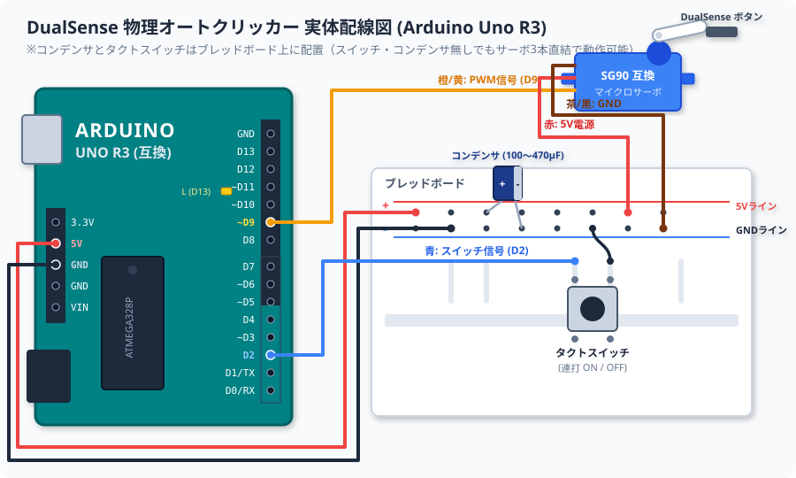
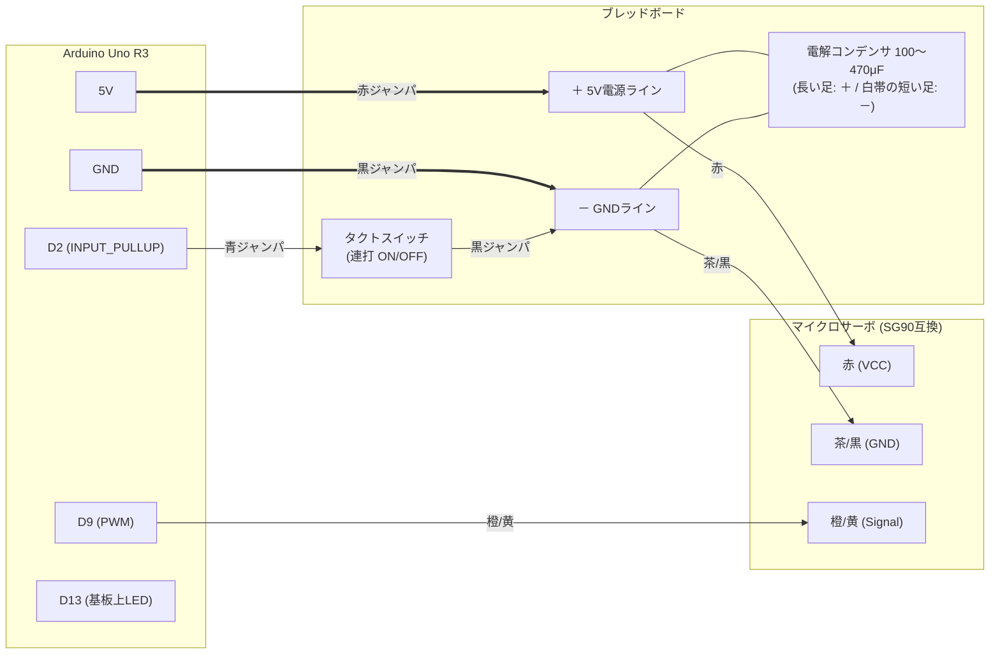

# 汎用オートクリッカー(物理)

サーボモータと Arduino Uno R3（互換機）を使った、DualSense等のコントローラーボタン用物理オートクリッカーです。

## ファイル構成

- [auto_clicker/auto_clicker.ino](file:///home/ny/dev/general-purpose-auto-clicker/auto_clicker/auto_clicker.ino) : Arduino IDE用スケッチ本体
- [docs/wiring.svg](file:///home/ny/dev/general-purpose-auto-clicker/docs/wiring.svg) : ブレッドボード実体配線図（SVGベクター画像）
- [diagram.json](file:///home/ny/dev/general-purpose-auto-clicker/diagram.json) : [Wokwi](https://wokwi.com/) シミュレータ用回路定義ファイル

---

## 1. 実体配線図（ブレッドボード＆Arduino Uno R3）



### ピン接続一覧表

| 部品・信号 | Arduino Uno ピン | ブレッドボード上の接続先 | 備考 |
| :--- | :--- | :--- | :--- |
| **電源 5V** | `5V` | 電源レール `+` (赤ライン) | サーボ電源用 |
| **電源 GND** | `GND` | 電源レール `-` (青/黒ライン) | 共通GND |
| **サーボ 赤 (VCC)** | (`5V`) | 電源レール `+` (赤ライン) | 4.8V〜6V |
| **サーボ 茶/黒 (GND)** | (`GND`) | 電源レール `-` (青/黒ライン) | |
| **サーボ 橙/黄 (PWM)** | `D9` | *(Arduino D9へ直結でOK)* | PWM信号線 |
| **タクトスイッチ（任意）** | `D2` と `GND` | 片足を `D2`、もう片足を `-` (GNDライン) | 内部プルアップ使用のため**抵抗不要** |
| **電解コンデンサ（任意）** | (`5V` と `GND`) | **長い足(+)** を `+`、**短い足/白帯(-)** を `-` | 100μF〜470μF程度。サーボ稼働時の瞬断（リセット）防止用 |

---

## 2. 論理ブロック図（Mermaid） & ブレッドボード穴位置ガイド



### アスキーアート配線メモ（テキストで確認したいとき用）

```text
[Arduino Uno R3]                  [ブレッドボード 電源レール]
  5V  o───────────────────────────> (+) 赤ライン ──┬── (長い足+) [コンデンサ]
  GND o───────────────────────────> (-) 青ライン ──┼── (短い足-) [100~470uF]
                                                   │
                                                   ├── 赤線 ───> [サーボ VCC]
                                                   ├── 茶線 ───> [サーボ GND]
  D9  o───────────────────────────(橙/黄線)────────┼───────────> [サーボ PWM]
                                                   │
  D2  o───────> [タクトスイッチ] ──────────────────┘
                 (押すとGNDに繋がりON/OFF切替)
```

---

## 3. 使い方・初期角度の合わせ方（重要）

最初からサーボホーン（白い羽根）を取り付けて動かすと、回転方向が逆だった場合にコントローラーを強く押しすぎてしまいます。以下の手順で調整すると安全です。

1. **白い羽根（サーボホーン）を外した状態**で Arduino に [auto_clicker.ino](file:///home/ny/dev/general-purpose-auto-clicker/auto_clicker/auto_clicker.ino) を書き込みます。
   - 起動すると自動的に待機角度（デフォルト `90度`）で止まります。
2. サーボ本体を DualSense のボタンの横に配置し、**ボタンの表面からほんの少し（1〜2mm）浮いた角度**になるように白い羽根を差し込みます。
3. Arduino IDE の **シリアルモニタ（ボーレート `115200`）** を開きます。
4. シリアルモニタから以下のコマンドを送って、ちょうどボタンを押せる角度を探ります：
   - `t` を送信：1回だけテストクリック（`pressAngle` へ動いて `releaseAngle` に戻る）
   - `p102` や `p108` などを送信：押し込む角度を変更（反対方向に回る場合は `p75` のように90より小さい値にします）
   - `r90` などを送信：待機位置の角度を微調整
5. ちょうどよく「カチッ」と押せる角度が見つかったら、`s` を送信（または `D2` ピンのスイッチを押す）すると自動連打が始まります。
6. 角度が決まったら、[auto_clicker.ino](file:///home/ny/dev/general-purpose-auto-clicker/auto_clicker/auto_clicker.ino#L12-L20) の初期値を書き換えておくと、次回からPC無し（モバイルバッテリーやUSB充電器のみ）でもその設定で動きます。

## 4. シリアルモニタのコマンド一覧（115200 bps）

| コマンド例 | 動作 |
| :--- | :--- |
| `t` | 単発テストクリック（1回押して戻す） |
| `s` | 自動連打ループの **開始 / 停止** トグル |
| `r90` | 待機時の角度を `90` 度に設定 |
| `p105` | 押下時の角度を `105` 度に設定 |
| `h100` | ボタンを押している時間を `100` msに設定 |
| `i1000` | 連打の最小待機間隔を `1000` msに設定 |
| `m1500` | 連打の最大待機間隔を `1500` msに設定（`i`と同じ値にすると完全一定間隔になります） |

---

## 5. Wokwi シミュレータでの動作確認方法

実機が手元になくても、ブラウザ上の [Wokwi](https://wokwi.com/projects/new/arduino-uno) で回路とプログラムの動作をテストできます。

1. [Wokwi (Arduino Uno 新規プロジェクト)](https://wokwi.com/projects/new/arduino-uno) を開きます。
2. エディタ画面の `sketch.ino` タブに [auto_clicker/auto_clicker.ino](file:///home/ny/dev/general-purpose-auto-clicker/auto_clicker/auto_clicker.ino) の中身を貼り付けます。
3. エディタ画面の `diagram.json` タブに、このリポジトリの [diagram.json](file:///home/ny/dev/general-purpose-auto-clicker/diagram.json) の中身を貼り付けます。
4. 緑色の **再生ボタン（Start the simulation）** を押すと、画面上のボタン押下やシリアルコマンド（`t` / `s` など）でサーボが動く様子を確認できます。
